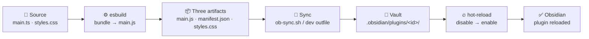
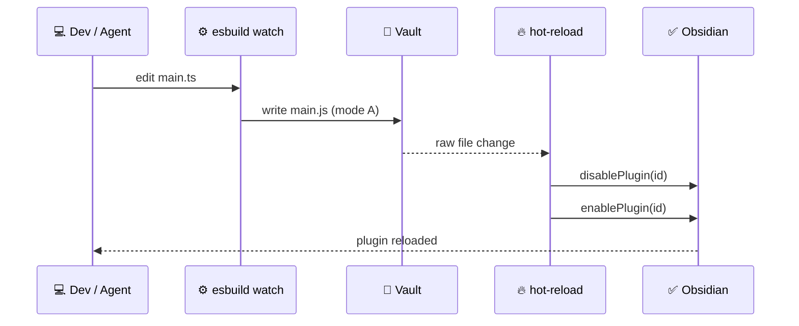

# cbugs-obsidian-agentflow

> An agent-ready development workflow for Obsidian community plugins: scaffold → build → auto-sync → hot-reload.

[简体中文](README.zh-CN.md) · [Documentation](docs/) · [Issues](https://github.com/uiots/cbugs-obsidian-agentflow/issues)

🧪 **Status:** A personal learning and rapid-prototyping toolkit for individual developers — one working setup codified into a copyable starting point, **not** a production framework, an Obsidian standard, or a team convention. Extend and adapt it to your own project; see [Customize](#customize).

---

## Overview



> 💡 The **copy step** (🔁) is where most setups break. This repository exists to make it automatic.

## Why

- 📦 [Obsidian](https://obsidian.md/) loads only **three artifacts** from `<vault>/.obsidian/plugins/<id>/`: `main.js`, `manifest.json`, `styles.css` — see [Build a plugin](https://docs.obsidian.md/Plugins/Getting+started/Build+a+plugin).
- 📁 Source normally lives in a separate dev directory; the vault contains only build output.
- ⚙️ [`esbuild --watch`](https://esbuild.github.io/) rebuilds `main.js` **locally** — nothing copies it into the vault.
- 👉 The result: the plugin never reloads, so you keep toggling it in Settings, or debug a change that was never deployed.

## Features

- 🧩 **Copyable scaffold** — `template/` is a complete plugin project, not a snippet.
- 📦 **Configurable sync** — `ob-sync.sh` reads `OBSIDIAN_PLUGINS_DIR` or `.vault-path` and **fails loudly** when the path is missing or wrong.
- 🔁 **One-command dev loop** — `esbuild.config.mjs` writes `main.js` straight into the vault during `dev`.
- 🔥 **Hot-reload included** — `hot-reload/` watches vault files; no `.hotreload` marker needed. [`pjeby/hot-reload`](https://github.com/pjeby/hot-reload) is an alternative.
- 🧪 **Sandbox-verified** — build, sync and watch were exercised against a throwaway vault, never an active one.
- 📚 **Honest docs** — conventions, 12 labelled pitfalls, a sourced tooling survey, and an explicit [scope note](docs/roadmap.md).

## What's included

| Path | What it is | Read it when |
| --- | --- | --- |
| [`AGENTS.md`](AGENTS.md) | Entry instructions + hard constraints for coding agents | You hand the repo to an agent |
| [`CUSTOMIZE.md`](CUSTOMIZE.md) | What **must** be replaced before adopting | **First, always** |
| [`docs/workflow.md`](docs/workflow.md) | Full scaffold → build → sync → reload → debug flow | Setting up / debugging |
| [`docs/conventions.md`](docs/conventions.md) | Naming, manifest, versioning, styling | Writing a plugin |
| [`docs/pitfalls.md`](docs/pitfalls.md) | 12 pitfalls: Verified / Researched / Trade-off | Something behaves oddly |
| [`docs/ecosystem-notes.md`](docs/ecosystem-notes.md) | Community tooling survey + evidence grades | Choosing a toolchain |
| [`docs/roadmap.md`](docs/roadmap.md) | Scope boundaries + optional extensions | Curious about what is outside this repo |
| [`rules/`](rules/) | Original conventions, scrubbed — reference only | Curious about the source setup |
| [`template/`](template/) | Plugin scaffold | Starting a new plugin |
| [`hot-reload/`](hot-reload/) | Self-built hot-reload plugin source | Enabling auto-reload |

> ⚠️ The `docs/` files are written in Chinese; this README has a full [简体中文](README.zh-CN.md) mirror.

## Requirements

- 🟢 Node.js 18+ and [`pnpm`](https://pnpm.io/) (npm / yarn / bun also work — see [`docs/conventions.md`](docs/conventions.md))
- 🖥️ Obsidian **desktop** — the bundled hot-reload plugin uses desktop-only APIs
- 🧪 A writable **sandbox vault** for verification — never your active vault
- 📐 [`TypeScript`](https://www.typescriptlang.org/) (bundled via [`template/`](template/))

## Quick start

```bash
git clone https://github.com/uiots/cbugs-obsidian-agentflow.git
cd cbugs-obsidian-agentflow

cat CUSTOMIZE.md                       # required: replace before adopting

cp -R template/ ../my-plugin
cd ../my-plugin
pnpm install

echo "/path/to/your/vault/.obsidian/plugins" > .vault-path
# or: export OBSIDIAN_PLUGINS_DIR=/path/to/your/vault/.obsidian/plugins

pnpm run sync                          # first deploy: copies the three artifacts
pnpm run dev                           # watch; writes main.js straight into the vault
```

1️⃣ Read [`CUSTOMIZE.md`](CUSTOMIZE.md) — plugin ID, author, vault path, tool versions.
2️⃣ Copy [`template/`](template/) into your own dev directory and install.
3️⃣ Point the workflow at a **sandbox** vault via `.vault-path` or `OBSIDIAN_PLUGINS_DIR`.
4️⃣ `pnpm run sync` once, then `pnpm run dev`; enable your plugin and `hot-reload/` in **Obsidian → Community plugins**.
5️⃣ Hand [`AGENTS.md`](AGENTS.md) to your coding agent, pointing it at [`docs/workflow.md`](docs/workflow.md).

## How it works



| | 🔁 Mode A — recommended | 📦 Mode B — manual |
| --- | --- | --- |
| Command | `pnpm run dev` | `pnpm run build` → `pnpm run sync` |
| Where `main.js` lands | Directly in the vault | Locally, then copied |
| Commands per change | **1** | **2** |
| Best for | Daily development | Release build / no vault path configured |
| Failure mode | Errors on bad path | Errors on bad path |

Both modes are detailed in [`docs/workflow.md`](docs/workflow.md). The bundled hot-reload plugin listens on vault file changes via `vault.on("raw")` and needs no `.hotreload` marker.

## Customize

[`CUSTOMIZE.md`](CUSTOMIZE.md) is required reading. Replace these before adopting:

- 🏷️ Plugin ID, display name and author (`template/manifest.json`, `package.json`, `main.ts`)
- 📁 Vault path — `OBSIDIAN_PLUGINS_DIR` / `.vault-path`
- 🧰 Package manager and tool versions (`pnpm@8`, `esbuild 0.17.3`, TypeScript)
- 🔀 Version-control system (`jj` in the original setup)
- 🔥 Hot-reload implementation — self-built vs [`pjeby/hot-reload`](https://github.com/pjeby/hot-reload)

> 💡 Treat [`docs/`](docs/) as a reference, combine it with your own stack, vault layout and release process, and **re-verify** anything labelled **Verified** / **【实测】** on your machine. [`rules/`](rules/) reflects one developer's environment, not platform requirements.

## Project status

| Stage | Status |
| --- | --- |
| Scaffold, naming / manifest conventions | ✅ Ready |
| `pnpm run build` | ✅ Verified in sandbox |
| `ob-sync.sh` — configurable path, fails loudly | ✅ Verified in sandbox |
| Dev-mode direct write to vault | ✅ Verified in sandbox |
| Hot-reload loop | ⚠️ Builds; source complete. In-app reload **not UI-verified**; uses internal APIs — see [`docs/pitfalls.md`](docs/pitfalls.md) |
> 📌 **Scope:** This repository covers the development loop — scaffold → build → auto-sync → hot-reload → debug. It **does not include** a release / publishing stage (tags, GitHub Actions, changelog, `versions.json`, community plugin submission, BRAT). This is a scope boundary, not a pending task: nothing here is waiting to be filled in, by contributors or by the author. See [`docs/roadmap.md`](docs/roadmap.md) for scope boundaries and community starting points if you want to wire up publishing in your own project.

## Documentation

| 📖 | Document | Focus |
| --- | --- | --- |
| 🧭 | [`docs/workflow.md`](docs/workflow.md) | End-to-end loop + debug checklist |
| 📐 | [`docs/conventions.md`](docs/conventions.md) | Conventions (generic vs original) |
| 🐛 | [`docs/pitfalls.md`](docs/pitfalls.md) | 12 pitfalls with evidence grades |
| 🔬 | [`docs/ecosystem-notes.md`](docs/ecosystem-notes.md) | Tooling survey + first-hand sources |
| 🗺️ | [`docs/roadmap.md`](docs/roadmap.md) | Scope boundaries + optional extensions |
| 🤖 | [`AGENTS.md`](AGENTS.md) | Agent instructions |
| 🔧 | [`CUSTOMIZE.md`](CUSTOMIZE.md) | Replacement checklist |

## References

| 🔗 | Source | Why it's here |
| --- | --- | --- |
| 🧩 | [`obsidianmd/obsidian-sample-plugin`](https://github.com/obsidianmd/obsidian-sample-plugin) | Upstream baseline: `esbuild` + TypeScript |
| ⚙️ | [`esbuild`](https://esbuild.github.io/) | Bundler used by `template/` |
| 📐 | [Plugin guidelines](https://docs.obsidian.md/Plugins/Releasing/Plugin+guidelines) | Community review rules |
| 🔥 | [`pjeby/hot-reload`](https://github.com/pjeby/hot-reload) | Alternative hot-reload plugin |
| 🚀 | [`obsidianmd/obsidian-workflows`](https://github.com/obsidianmd/obsidian-workflows) | Release automation — outside this repo's scope |
| 📏 | [Standard Readme](https://github.com/richardlitt/standard-readme) | Structure followed by this README |

## Contributing

Issues and PRs are welcome 🙌

- ✅ Label a pitfall **Verified** (with OS / Obsidian / tool versions) or **Inferred** — see [`docs/pitfalls.md`](docs/pitfalls.md).
- 🚫 Never commit secrets, real vault paths, `main.js` or `node_modules/`.
- 🧪 Verify changes against a sandbox vault, and note what you actually ran.

## License

MIT — see [`LICENSE`](LICENSE).
