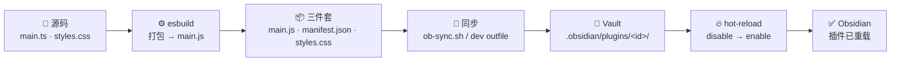
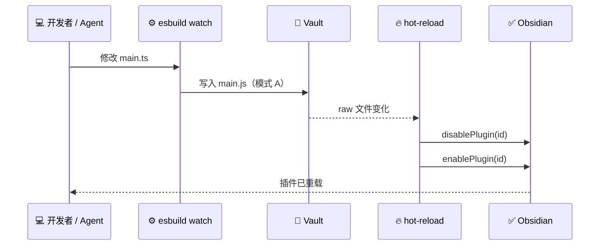

# cbugs-obsidian-agentflow

> 一套给 coding agent 用的 Obsidian 社区插件开发工作流：脚手架 → 构建 → 自动同步 → 热重载。

[English](README.md) · [文档](docs/) · [Issues](https://github.com/uiots/cbugs-obsidian-agentflow/issues)

🧪 **项目状态：** 面向独立开发者的个人验证与快速实践工具、学习项目——把一套能跑通的配置沉淀成可复制的起点，**不是**生产级框架、Obsidian 官方标准或团队规范。请按需扩展，结合你自己的项目调整；见[定制](#定制)。

---

## 概览



> 💡 大多数配置出问题的就是这一步 **🔁 搬运**。本仓库就是为了把它变成自动的。

## 为什么需要它

- 📦 [Obsidian](https://obsidian.md/) 从 `<vault>/.obsidian/plugins/<id>/` 只加载**三个产物**：`main.js`、`manifest.json`、`styles.css`——见 [Build a plugin](https://docs.obsidian.md/Plugins/Getting+started/Build+a+plugin)。
- 📁 源码通常放在独立的开发目录里，vault 里只有构建产物。
- ⚙️ [`esbuild --watch`](https://esbuild.github.io/) 只在**本地**重建 `main.js`，不会把它搬进 vault。
- 👉 结果：插件始终不重载，你只能反复去设置里开关，或者在调试一个根本没部署的改动。

## 特性

- 🧩 **可复制的脚手架**——`template/` 是完整插件工程，不是代码片段。
- 📦 **可配置的同步**——`ob-sync.sh` 读取 `OBSIDIAN_PLUGINS_DIR` 或 `.vault-path`，路径缺失或写错时**明确报错退出**。
- 🔁 **一条命令的开发闭环**——`dev` 模式下 `esbuild.config.mjs` 把 `main.js` 直接写进 vault。
- 🔥 **自带热重载**——`hot-reload/` 监听 vault 文件，不需要 `.hotreload` 标记；[`pjeby/hot-reload`](https://github.com/pjeby/hot-reload) 是备选。
- 🧪 **sandbox 实跑验证**——构建、同步、watch 都在一次性 vault 上跑过，没碰活跃库。
- 📚 **诚实的文档**——约定、12 条标注来源的踩坑、有证据等级的调研，以及明确的[范围说明](docs/roadmap.md)。

## 仓库内容

| 路径 | 是什么 | 什么时候读 |
| --- | --- | --- |
| [`AGENTS.md`](AGENTS.md) | 给 coding agent 的入口指令与硬约束 | 把仓库交给 Agent 时 |
| [`CUSTOMIZE.md`](CUSTOMIZE.md) | 采用前**必须**替换的清单 | **永远第一步** |
| [`docs/workflow.md`](docs/workflow.md) | 脚手架 → 构建 → 同步 → 重载 → debug 全流程 | 搭环境 / 排查 |
| [`docs/conventions.md`](docs/conventions.md) | 命名、manifest、版本、样式约定 | 写插件时 |
| [`docs/pitfalls.md`](docs/pitfalls.md) | 12 条踩坑：【实测】/【调研】/【取舍】 | 行为反常时 |
| [`docs/ecosystem-notes.md`](docs/ecosystem-notes.md) | 社区工具链调研 + 证据等级 | 选技术栈时 |
| [`docs/roadmap.md`](docs/roadmap.md) | 范围界定 + 可选扩展方向 | 想知道仓库不包含什么 |
| [`rules/`](rules/) | 已脱敏的原始规范，仅作参考 | 想了解这套配置的来历 |
| [`template/`](template/) | 插件脚手架 | 新建插件时 |
| [`hot-reload/`](hot-reload/) | 自研热重载插件源码 | 启用自动重载时 |

> ⚠️ `docs/` 下的文档为中文；README 提供英文主版与完整的[简体中文](README.zh-CN.md)同版本。

## 环境要求

- 🟢 Node.js 18+ 与 [`pnpm`](https://pnpm.io/)（npm / yarn / bun 亦可，见 [`docs/conventions.md`](docs/conventions.md)）
- 🖥️ Obsidian **桌面端**——自带的热重载插件使用了桌面端限定 API
- 🧪 一个可写的 **sandbox vault** 用于验证——绝不要用活跃库
- 📐 [`TypeScript`](https://www.typescriptlang.org/)（随 [`template/`](template/) 提供）

## 快速开始

```bash
git clone https://github.com/uiots/cbugs-obsidian-agentflow.git
cd cbugs-obsidian-agentflow

cat CUSTOMIZE.md                       # 必读：采用前先按需替换

cp -R template/ ../my-plugin
cd ../my-plugin
pnpm install

echo "/path/to/your/vault/.obsidian/plugins" > .vault-path
# 或：export OBSIDIAN_PLUGINS_DIR=/path/to/your/vault/.obsidian/plugins

pnpm run sync                          # 首次部署：搬运三件套
pnpm run dev                           # watch；main.js 直接写进 vault
```

1️⃣ 读 [`CUSTOMIZE.md`](CUSTOMIZE.md)——插件 ID、作者、vault 路径、工具版本。
2️⃣ 把 [`template/`](template/) 复制进你自己的开发目录并安装依赖。
3️⃣ 用 `.vault-path` 或 `OBSIDIAN_PLUGINS_DIR` 指向 **sandbox vault**。
4️⃣ 先跑一次 `pnpm run sync`，再 `pnpm run dev`；在 **Obsidian → 社区插件**里启用你的插件与 `hot-reload/`。
5️⃣ 把 [`AGENTS.md`](AGENTS.md) 交给你的 coding agent，并让它读 [`docs/workflow.md`](docs/workflow.md)。

## 工作原理



| | 🔁 模式 A（推荐） | 📦 模式 B（手动） |
| --- | --- | --- |
| 命令 | `pnpm run dev` | `pnpm run build` → `pnpm run sync` |
| `main.js` 落到哪 | 直接进 vault | 先本地，再搬运 |
| 每次改动几条命令 | **1** | **2** |
| 适合 | 日常开发 | 发布构建 / 未配置 vault 路径 |
| 路径写错时 | 报错退出 | 报错退出 |

两种模式详见 [`docs/workflow.md`](docs/workflow.md)。自带的热重载插件通过 `vault.on("raw")` 监听 vault 内文件变化，不需要 `.hotreload` 标记。

## 定制

[`CUSTOMIZE.md`](CUSTOMIZE.md) 是必读。采用前请替换：

- 🏷️ 插件 ID、显示名与作者（`template/manifest.json`、`package.json`、`main.ts`）
- 📁 Vault 路径——`OBSIDIAN_PLUGINS_DIR` / `.vault-path`
- 🧰 包管理器与工具版本（`pnpm@8`、`esbuild 0.17.3`、TypeScript）
- 🔀 版本控制系统（原配置用 `jj`）
- 🔥 热重载实现——自研版 vs [`pjeby/hot-reload`](https://github.com/pjeby/hot-reload)

> 💡 把 [`docs/`](docs/) 当作参考，结合你自己的技术栈、vault 布局与发布流程来扩展，并在自己机器上**复验**标 **【实测】/ Verified** 的结论。[`rules/`](rules/) 反映的是某一个开发者的环境，不是平台要求。

## 项目状态

| 阶段 | 状态 |
| --- | --- |
| 脚手架、命名 / manifest 约定 | ✅ 可用 |
| `pnpm run build` | ✅ sandbox 实跑验证 |
| `ob-sync.sh`（路径可配置、缺失报错） | ✅ sandbox 实跑验证 |
| dev 模式直写 vault | ✅ sandbox 实跑验证 |
| 热重载闭环 | ⚠️ 可构建、源码齐备；**实际重载未在 Obsidian 内驱动验证**，依赖内部 API——见 [`docs/pitfalls.md`](docs/pitfalls.md) |
> 📌 **范围说明：** 本仓库覆盖的是开发闭环——脚手架 → 构建 → 自动同步 → 热重载 → debug，**不包含** release / 发布部分（tag、GitHub Actions、changelog、`versions.json`、社区目录提交、BRAT）。这是范围界定，不是待办事项：既不需要贡献者来填补，也不存在「等我们自己补上」。若你要在自己的项目里接发布，可参考 [`docs/roadmap.md`](docs/roadmap.md) 里的范围说明与社区现成做法。

## 文档

| 📖 | 文档 | 内容 |
| --- | --- | --- |
| 🧭 | [`docs/workflow.md`](docs/workflow.md) | 端到端闭环 + debug 清单 |
| 📐 | [`docs/conventions.md`](docs/conventions.md) | 约定（通用版 vs 原始规范） |
| 🐛 | [`docs/pitfalls.md`](docs/pitfalls.md) | 12 条踩坑与证据等级 |
| 🔬 | [`docs/ecosystem-notes.md`](docs/ecosystem-notes.md) | 工具链调研 + 一手来源 |
| 🗺️ | [`docs/roadmap.md`](docs/roadmap.md) | 范围界定 + 可选扩展方向 |
| 🤖 | [`AGENTS.md`](AGENTS.md) | Agent 指令 |
| 🔧 | [`CUSTOMIZE.md`](CUSTOMIZE.md) | 替换清单 |

## 参考链接

| 🔗 | 来源 | 为什么放这里 |
| --- | --- | --- |
| 🧩 | [`obsidianmd/obsidian-sample-plugin`](https://github.com/obsidianmd/obsidian-sample-plugin) | 上游基线：`esbuild` + TypeScript |
| ⚙️ | [`esbuild`](https://esbuild.github.io/) | `template/` 使用的打包器 |
| 📐 | [Plugin guidelines](https://docs.obsidian.md/Plugins/Releasing/Plugin+guidelines) | 社区审核规则 |
| 🔥 | [`pjeby/hot-reload`](https://github.com/pjeby/hot-reload) | 备选热重载插件 |
| 🚀 | [`obsidianmd/obsidian-workflows`](https://github.com/obsidianmd/obsidian-workflows) | 发布自动化——不在本仓库范围内 |
| 📏 | [Standard Readme](https://github.com/richardlitt/standard-readme) | 本 README 遵循的结构规范 |

## 贡献

欢迎 issue 与 PR 🙌

- ✅ 补充踩坑时标注 **【实测】**（附 OS / Obsidian / 工具版本）或 **【推测】**——见 [`docs/pitfalls.md`](docs/pitfalls.md)。
- 🚫 不要提交密钥、真实 vault 路径、`main.js` 或 `node_modules/`。
- 🧪 改动请在 sandbox vault 上验证，并写明你实际跑了什么。

## 许可

MIT — 见 [`LICENSE`](LICENSE)。
